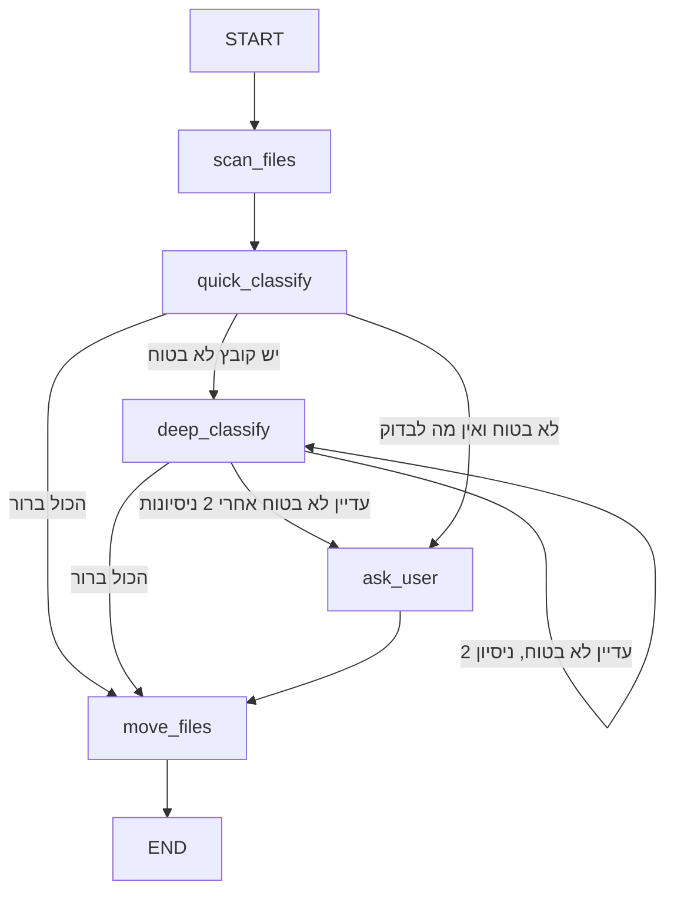

# 🧹 סוכן לסידור תיקיית ההורדות

סוכן AI שמסדר את תיקיית ההורדות בלחיצה אחת. הוא **מבין את התוכן** של כל קובץ, ולא רק את הסיומת.
למשל: צילום מסך של קוד הולך ל**לימודים**, ותמונה רגילה הולכת ל**תמונות**.

נבנה עם **LangGraph**, **LangChain**, **Gemini** ו־**LangSmith**.

---

## 📂 לאן הולך כל קובץ

| סוג | איך מחליטים | יעד |
|---|---|---|
| 🎵 שירים | לפי סיומת, בלי מודל | `Music\שירים הורדות` |
| 🎬 סרטון רגיל | המודל מסתכל על צילומים מתוך הסרטון | `Videos\סרטי וידאו` |
| 📄 מסמך אישי | המודל קורא את התוכן | `Documents\מסמכים הורדות` |
| 🖼️ תמונה רגילה | המודל מסתכל על התמונה | `Pictures\תמונות הורדות` |
| 📚 כל דבר לימודי (מסמך, תמונה, סרטון) | המודל מבין את התוכן | `Downloads\לימודים` |
| ❓ לא ברור | הסוכן שואל אותי | לפי הבחירה שלי: תיקייה, מחיקה לסל המיחזור, או השארה |

---

## 🗺️ מבנה הגרף



| תחנה | מה היא עושה |
|---|---|
| `scan_files` | סורקת את התיקייה ויוצרת כרטיס לכל קובץ. שירים מסווגים כאן לפי סיומת, בלי מודל |
| `quick_classify` | המודל מסווג **לפי שם הקובץ בלבד** (מהיר וזול), וממלא טופס: קטגוריה, בטוח/לא, וסיבה |
| `deep_classify` | לקבצים לא ברורים: המודל **מסתכל על התוכן** (תמונה, צילומים מסרטון, טקסט ממסמך). בניסיון השני הוא מקבל יותר תוכן |
| `ask_user` | ✋ `interrupt`: עוצרת ושואלת אותי **רק** על קבצים שהסוכן לא הצליח להחליט לגביהם |
| `move_files` | מעבירה לתיקיות, מוחקת לסל המיחזור, או משאירה |

---

## ✅ איך הפרויקט עונה על הדרישות

| דרישה | איפה בפרויקט |
|---|---|
| שימוש ב־LangGraph | `graph.py`: ‏`StateGraph` עם 5 תחנות |
| ענף מותנה | `route_after_classify` בוחר בין `deep_classify`, `ask_user` ו־`move_files` |
| לולאה | `deep_classify` יכול לחזור לעצמו (עד `MAX_DEEP_ATTEMPTS = 2`, כדי שהלולאה לא תהיה אינסופית) |
| interrupt ו־human-in-the-loop | `ask_user` עוצר עם `interrupt()`. ממשיכים עם `Command(resume=...)`. ה־checkpointer הוא `InMemorySaver` |
| Dataset והערכה ב־LangSmith, לפני ואחרי | `evaluate.py`: ‏dataset של 10 קבצים, evaluator, ושני ניסויים (v1 מול v2) |
| README עם traces ותובנה | המסמך הזה 🙂 |

> 💡 **החלטת עיצוב:** הסוכן **לא** מבקש אישור על כל קובץ, כי זה היה מבטל את הטעם בסוכן. הוא עוצר לשאול רק כשהוא באמת לא יודע, אחרי שתי בדיקות עומק.

---

## 🎥 Traces מ־LangSmith

### Trace של הרצה מלאה


### רשימת ההרצות: איטית (71 שנ׳) מול מהירה (3.8 שנ׳)


### לפני ואחרי: זמן הריצה
| לפני | אחרי |
|---|---|
|  |  |

### 💡 התובנה מה־traces
בהרצה הראשונה, הסוכן לקח **71 שניות**.
ב־trace ראיתי שכל קריאה ל־Gemini שולחת בערך **280 tokens**, אבל זמן התגובה נע בין **0.9 ל־13.8 שניות**.
כלומר, האיטיות **לא** נבעה מגודל ה־prompt, אלא מזמן ההמתנה בשכבה החינמית של ה־API.
וכי הקריאות רצו אחת אחרי השנייה (`max_concurrency=1`, כדי לא להיחסם בשגיאת 429), הזמנים **הצטברו**.

**השיפור:** עברתי למודל `gemini-3.5-flash-lite` והעליתי ל־2 קריאות במקביל.
עכשיו תחנת הסיווג לוקחת **3.66 שניות** במקום כ־31, כי הזמן הוא בערך של הקריאה הארוכה ביותר ולא הסכום של כולן.

---

## 📊 הערכה אוטומטית: לפני ואחרי שיפור

**Dataset:** ‏10 קבצים עם שמות לא ברורים (`IMG_001.png`, `doc2.txt`...), כולל מקרים קשים:
שתי תמונות עם שמות דומים, שאחת מהן לימודית ואחת לא; קבלה מול תרגיל, ששניהם קבצי טקסט; וקובץ בינארי שאי אפשר להבין.

**Evaluator:** ‏`correct_category` בודק אם הקטגוריה שהסוכן בחר שווה לתשובה הנכונה.

| ניסוי | מה הסוכן עושה | ציון |
|---|---|---|
| `v1-name-only` (לפני) | מחליט **רק לפי שם הקובץ** | **50%** (5 מתוך 10) |
| `v2-deep-look` (אחרי) | כשהוא לא בטוח, **מסתכל על התוכן** (הלולאה) | **100%** (10 מתוך 10) |


**המסקנה:** בדיקת העומק (`deep_classify` והלולאה) היא מה שמאפשר לסוכן להבדיל בין "סתם תמונה" ל"תמונה של לימודים". בלעדיה, הסוכן לא יכול לדעת מה יש בקובץ עם שם לא ברור.

---

## 🛠️ הרצה

```bash
pip install langgraph langchain langchain-google-genai langsmith python-dotenv pypdf python-docx opencv-python send2trash truststore
```

קובץ `.env`:
```
GOOGLE_API_KEY=...
LANGSMITH_TRACING=true
LANGSMITH_API_KEY=...
LANGSMITH_PROJECT=downloads-agent
```

- `python run.py`: מסדר את תיקיית ההורדות מהטרמינל
- `app.pyw`: **חלון עם כפתור** 🧹. לוחצים, והסוכן מסדר. אם יש קובץ לא ברור, נפתח חלון שאלה
- `create_shortcut.vbs`: לחיצה כפולה יוצרת קיצור דרך בשולחן העבודה. קליק ימני עליו, ואז "הצמד לשורת המשימות"
- `python evaluate.py`: מריץ את שני הניסויים ב־LangSmith
- ב־`config.py`: ‏`TEST_MODE = True` כדי לעבוד על תיקיות ניסוי (`test_downloads` ← `test_output`) במקום על ההורדות האמיתיות

## 📁 קבצים
| קובץ | תפקיד |
|---|---|
| `config.py` | הגדרות: מודל, תיקיות, סיומות |
| `state.py` | ה־State (התיק המשותף) והטופס `Classification` |
| `file_readers.py` | קריאת תוכן: תמונות, צילומים מסרטונים, טקסט ממסמכים |
| `nodes.py` | כל התחנות ופונקציית הניתוב |
| `graph.py` | בניית הגרף |
| `run.py` | הרצה מהטרמינל, כולל מענה ל־interrupt |
| `app.pyw` | אפליקציה עם כפתור, וחלון שאלה ל־interrupt |
| `evaluate.py` | dataset, evaluator ושני ניסויים |

## 🔒 פרטיות
תמונות ומסמכים נשלחים ל־Gemini ונשמרים ב־traces של LangSmith. בזמן הפיתוח השתמשתי רק בקבצי ניסוי שאינם אישיים.
